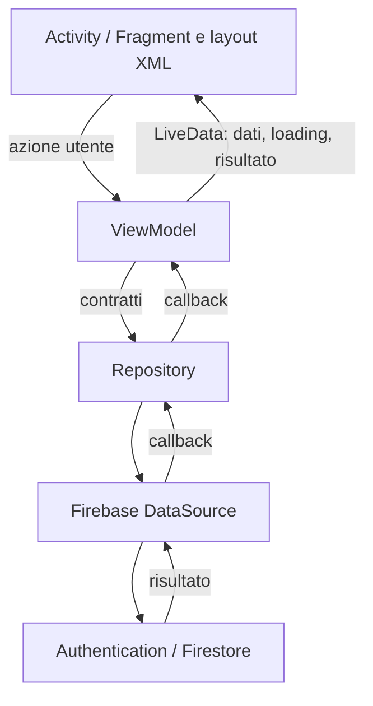

# Architettura di ChaletTime

Questo documento descrive l'applicazione Android, la separazione MVVM, il percorso seguito dalle operazioni e la funzione dei file del progetto. I percorsi delle classi Java riportati nelle tabelle sono relativi a `app/src/main/java/com/francesco/chalettime/`; quelli delle risorse sono relativi a `app/src/main/res/`.

## 1. Che cosa fa l'app

ChaletTime registra le ore lavorate dai dipendenti. L'utente accede oppure crea un profilo; dopo l'autenticazione, il ruolo memorizzato in Firestore determina la schermata principale.

- **Dipendente:** sceglie una data, seleziona da 1 a 16 ore a intervalli di mezz'ora e salva una registrazione; può uscire dall'account.
- **Amministratore:** consulta i dipendenti, cambia il mese, cerca per nome e apre il profilo di una persona per vedere le registrazioni del mese scelto; può uscire dall'account.
- **Accesso:** comprende registrazione e recupero password via e-mail.

I percorsi funzionali sono conservati: il rinnovo grafico non introduce sezioni o passaggi aggiuntivi. Gli interventi sulla logica impediscono invii duplicati durante una richiesta, rifiutano registrazioni incomplete e conservano il modulo in caso di errore.

## 2. Tecnologie e struttura generale

È un'app Android nativa **Java + XML Views**, con un unico modulo `app`. Non usa Jetpack Compose. La configurazione Gradle è scritta in Kotlin DSL: questo non significa che l'applicazione sia implementata in Kotlin.

| Componente | Impiego |
| --- | --- |
| AppCompat e Material Components 3 | Activity, temi, campi, pulsanti, card e indicatori |
| Navigation Component | Navigazione tra Fragment e ripristino del back stack |
| ViewModel | Stato e coordinamento delle operazioni delle schermate |
| LiveData | Stato osservabile legato al ciclo di vita della UI |
| Repository e DataSource | Contratti di accesso ai dati e implementazione Firebase |
| Firebase Authentication | Account, sessione, login, logout e recupero password |
| Cloud Firestore | Profili e registrazioni delle ore |
| JUnit e AndroidX Core Testing | Test unitari dei ViewModel con repository simulati |
| AndroidX Test e ActivityScenario | Test sul dispositivo di navigazione e layout |

`minSdk` è 24, `compileSdk` è 35 e `targetSdk` è 34. Il codice Java viene compilato con compatibilità Java 11; per eseguire Gradle occorre un JDK compatibile con Android Gradle Plugin, almeno 17. Le versioni effettive delle dipendenze si trovano in `gradle/libs.versions.toml`.

## 3. Verifica MVVM: situazione iniziale e interventi

All'inizio l'applicazione aveva già un livello repository e un livello Firebase, ma MVVM era applicata solo parzialmente. `AdminViewModel` conservava mese e lista; i Fragment eseguivano ancora richieste, calcoli delle ore e autenticazione. `MainActivity` interrogava direttamente Firestore. Le callback aggiornando direttamente le View potevano inoltre arrivare dopo la distruzione della schermata.

La struttura attuale assegna le responsabilità in questo modo:

| Livello | Responsabilità | Che cosa non gestisce |
| --- | --- | --- |
| View: Activity, Fragment, XML e adapter | Lettura dei campi, picker, rendering, messaggi e navigazione | Query Firestore, autenticazione Firebase e aggregazioni |
| ViewModel | Operazioni della schermata, stato, validazione del salvataggio, filtri e coordinamento asincrono | View, Context, Activity, Fragment e NavController |
| Repository | Contratto applicativo e delega verso la sorgente dati | Layout e navigazione |
| DataSource | SDK Firebase, documenti, query e transazioni | Stato della schermata |
| Model | Dati di profilo e ore e modello della riga dipendente | Operazioni di rete e riferimenti alle View |



Non è necessario Data Binding per usare MVVM: qui il collegamento è esplicito con `observe(...)`. Non sono stati aggiunti Hilt o un livello di use case perché, per la dimensione attuale, non risolverebbero una complessità concreta. Ogni ViewModel ha un costruttore predefinito per `ViewModelProvider` e un costruttore che riceve le interfacce repository per i test. Nei costruttori predefiniti la composizione delle implementazioni è ancora manuale.

L'interfaccia `AuthRepository` espone callback applicative e un ID stringa: non restituisce più `FirebaseUser`, `AuthResult` o `Task`. Nessuna Activity o Fragment dipende direttamente dai repository o dall'SDK Firebase. Gli avatar sono ora simboli vettoriali neutri; il genere è mostrato con un’etichetta testuale nella lista e nel dettaglio. Il DataSource restituisce il genere come dato e non sceglie immagini.

## 4. Stato, ciclo di vita e operazioni asincrone

### Osservazione dello stato

I ViewModel mantengono `MutableLiveData` privati o protetti ed espongono `LiveData` in sola lettura. Le schermate inviano comandi come `login()`, `save()`, `selectMonth()` e `load()`; non modificano direttamente le liste del ViewModel.

I Fragment osservano usando `getViewLifecycleOwner()`. Quando viene distrutta la View, gli observer vengono rimossi automaticamente; quando la schermata viene ricreata, gli observer ricevono nuovamente lo stato conservato. I riferimenti ai campi di login e registrazione vengono rilasciati in `onDestroyView()`.

`loading` controlla indicatori e pulsanti. I comandi di autenticazione e salvataggio verificano anche nel ViewModel se una richiesta è già in corso: la protezione non dipende soltanto dal pulsante disabilitato.

### Risultati da gestire una volta

`UiEvent<T>` avvolge messaggi, autenticazione riuscita e salvataggio riuscito. `consume()` restituisce il contenuto solo alla prima lettura. Questo impedisce, per esempio, di aprire due volte `MainActivity` dopo una rotazione o di svuotare nuovamente il modulo per un salvataggio già gestito.

È una soluzione locale per una schermata consumatrice, non una coda di eventi: due messaggi consecutivi mentre la UI è inattiva possono essere rappresentati soltanto dall'ultimo valore LiveData. Gli eventi non sono persistiti su disco.

### Scope dei ViewModel

| ViewModel | Proprietario | Conseguenza |
| --- | --- | --- |
| `AuthViewModel` | Singolo Fragment di login o registrazione | Le due schermate hanno operazioni indipendenti |
| `HomeViewModel` | `HomeFragment` | Un salvataggio sopravvive alla ricreazione della View |
| `AdminViewModel` | `MainActivity` | Mese, ricerca e lista restano disponibili tornando dal dettaglio |
| `UserDetailsViewModel` | `UserDetailsFragment` | Profilo e registrazioni non vengono ricaricati a ogni ricreazione |
| `MainViewModel` | `MainActivity` | Il ruolo viene richiesto una volta per l'istanza logica dell'Activity |

I ViewModel sopravvivono alle modifiche di configurazione, non alla terminazione del processo. Non è implementato `SavedStateHandle`: dopo un nuovo processo i dati vengono nuovamente richiesti e il mese amministratore può tornare al mese corrente. Il normale ripristino dei campi e del back stack è affidato a Android e Navigation.

### Risposte in ritardo

`AdminViewModel` assegna un numero progressivo a ogni caricamento mensile. Le callback verificano che la richiesta sia ancora quella corrente prima di pubblicare dati o errori. Un risultato di gennaio che arriva dopo la selezione di febbraio non può sovrascrivere febbraio.

Le risposte dei singoli dipendenti vengono ricomposte mantenendo l'ordine della lista iniziale. Il filtro di ricerca si applica anche quando la risposta arriva dopo la digitazione. La lista vuota termina correttamente il caricamento, senza aspettare callback che non arriveranno.

`BaseViewModel.onCleared()` marca l'istanza come terminata; le callback dei ViewModel ignorano i risultati successivi. Le richieste Firebase già partite non vengono cancellate: possono terminare, ma non trattengono né aggiornano una View distrutta. Le callback delle implementazioni repository usate nell'app arrivano sul thread principale tramite i listener Firebase.

## 5. Flussi applicativi nel dettaglio

### 5.1 Avvio e accesso

1. Il Manifest apre `WelcomeActivity`, che ospita `welcome_nav_graph.xml`.
2. La destinazione iniziale è `LoginFragment`.
3. Il Fragment controlla che i campi obbligatori siano compilati e chiama `AuthViewModel.login()`.
4. Il ViewModel imposta `loading`, chiama `AuthRepository` e attende il risultato.
5. Il repository delega a `FirebaseAuthDataSource`, che usa Firebase Authentication.
6. In caso di successo il ViewModel pubblica un evento; il Fragment apre `MainActivity` e pulisce lo stack delle schermate di accesso.
7. In caso di errore viene mostrato un messaggio e il pulsante torna disponibile.

Il link di registrazione usa Navigation; il recupero password richiede l'e-mail e passa attraverso lo stesso ViewModel, repository e DataSource. Il link verso un'altra schermata viene disabilitato durante l'autenticazione per evitare che navighi mentre arriva il risultato.

### 5.2 Registrazione

`RegisterFragment` raccoglie nome, cognome, data di nascita, genere, e-mail e password. La data usa un calendario senza date future. `AuthViewModel` crea l'account e poi salva il documento profilo. L'evento di successo viene emesso solo dopo il salvataggio del profilo, non appena l'account Firebase è stato creato.

La regola preesistente assegna `admin` all'e-mail `admin@gmail.com` e `user` alle altre; è conservata per non cambiare il comportamento attuale. Questa condizione nel client non costituisce un controllo di autorizzazione: i privilegi effettivi devono essere protetti dalle regole Firestore o assegnati da un backend fidato. Il repository non contiene le regole Firestore distribuite, quindi la loro correttezza non è verificabile dal solo codice Android.

La creazione dell'account Authentication e il salvataggio del profilo sono due operazioni distinte: non costituiscono una transazione unica. Se la seconda fallisce, l'account può essere già stato creato; il messaggio segnala il problema, ma non è stato introdotto un flusso di riparazione dell'account.

### 5.3 Scelta della schermata dopo l'accesso

`MainViewModel` verifica che esista un ID di sessione e richiede il profilo tramite `UserDetailsRepository`. `MainActivity` imposta programmaticamente la destinazione iniziale del grafo: amministrazione per `admin`, inserimento ore per gli altri ruoli.

Il grafo non viene più avviato dall'XML prima di conoscere il ruolo. In questo modo un dipendente non carica brevemente il Fragment amministratore e non provoca richieste della lista utenti. Se Navigation ha già una destinazione ripristinata, l'Activity non reinizializza lo stack. Senza sessione si torna alla schermata di accesso; un errore di caricamento del profilo viene comunicato e riporta all'accesso.

### 5.4 Inserimento ore

1. `HomeFragment` apre il calendario e il selettore delle ore. Il selettore conserva gli stessi valori da 1 a 16, con mezze ore.
2. La conferma invia stringa della data e ore a `HomeViewModel.save()`.
3. Il ViewModel controlla sessione, formato e validità della data e valori ammessi delle ore. Una registrazione vuota o non valida non arriva al repository.
4. Il repository delega a `FirebaseUserWorkLogDataSource`.
5. Il DataSource legge e aggiunge la registrazione in una **transazione Firestore**. Se due scritture concorrenti modificano lo stesso documento, Firestore può riprovare la transazione evitando che una lista sovrascriva l'altra.
6. Solo dopo il successo il Fragment svuota data e ore. In caso di errore conserva i campi per consentire un nuovo tentativo.

La transazione mantiene la struttura a lista e la possibilità preesistente di inserire più registrazioni per la stessa data. Non è un meccanismo di deduplicazione fra dispositivi o richieste distinte. Le transazioni richiedono una connessione al server; non è stato introdotto un sistema applicativo di accodamento offline.

### 5.5 Elenco amministratore

`AdminFragment` inoltra selezione del mese e ricerca al ViewModel. `AdminViewModel` carica i profili con ruolo `user` e richiede le registrazioni di ciascuna persona. Somma le ore con anno corrente e mese scelto, ignorando le date non interpretabili, e pubblica la lista filtrata.

La selezione del mese è compresa fra 1 e 12. Non c'è un selettore dell'anno: come nell'app originale, il riferimento è l'anno corrente. Il parametro anno/mese del metodo `fetchUserWorkLogs()` non produce una query mensile lato server: il DataSource legge il documento completo e il ViewModel applica il filtro.

Toccando una riga, la View passa `userId`, `userName` e `selectedMonth` al dettaglio. Il mese e la ricerca restano nel ViewModel condiviso dell'Activity.

### 5.6 Dettaglio dipendente e ritorno

`UserDetailsViewModel` richiede in parallelo profilo e registrazioni del mese. Mantiene separatamente `user`, `workLogs` e `loading`; l'indicatore termina quando entrambe le richieste hanno risposto, anche in caso di errore.

Il Fragment mostra nome, nascita, avatar neutro, genere testuale e righe delle ore. Le registrazioni vengono ordinate per stringa `dd/MM/yyyy`; nel medesimo mese, con il formato normalizzato usato dai picker, questo equivale all'ordine dei giorni. Non è un ordinamento generale di date appartenenti a mesi diversi.

Il pulsante indietro esegue `popBackStack()`: riapre l'elenco esistente e conserva il filtro senza accumulare nuove copie della schermata amministratore. L'azione inversa definita nel grafo rimane disponibile, ma il pulsante usa il ritorno sullo stack.

### 5.7 Logout

Le schermate chiamano il rispettivo ViewModel, che esegue `AuthRepository.signOut()`. La View apre `WelcomeActivity` con `NEW_TASK | CLEAR_TASK`, così il pulsante indietro non riapre le schermate della sessione precedente. `MainActivity` non è esportata verso altre applicazioni.

## 6. Modello dati Firestore

```text
users/{uid}
  name: String
  surname: String
  dateOfBirth: String       // dd/MM/yyyy
  email: String
  role: String              // user oppure admin
  gender: String            // Maschio oppure Femmina nel modulo attuale

work_logs/{uid}
  userId: String
  logs: Array
    - userId: String
      date: String          // dd/MM/yyyy
      hours: Number
```

I costruttori vuoti dei POJO consentono a Firestore di ricostruire i dati; i getter espongono i campi durante la serializzazione. `Employee` è invece un modello di presentazione della lista amministratore: contiene nome completo, riepilogo ore e genere, non un riferimento a una drawable Android.

I documenti già presenti privi dei campi `userId` aggiuntivi rimangono leggibili: gli identificatori usati nelle query provengono dai percorsi dei documenti. I nuovi salvataggi espongono esplicitamente l'ID con i getter.

Il modello con tutte le registrazioni in un solo documento per persona è conservato. Per molti anni di dati può avvicinarsi ai limiti di dimensione del documento Firestore e richiedere una migrazione verso sottocollezioni; tale migrazione non fa parte del rinnovo dell'interfaccia.

## 7. Classi Java, file per file

### 7.1 Schermate

| File | Funzionamento |
| --- | --- |
| `ui/welcome/WelcomeActivity.java` | Activity di ingresso. Carica `activity_welcome.xml`; lascia al NavHost la navigazione login/registrazione. Non avvia operazioni dati. |
| `ui/welcome/fragment/LoginFragment.java` | Legge e-mail e password, mostra gli errori dei campi, inoltra login/recupero al ViewModel e osserva loading, messaggi e autenticazione. Apre la registrazione o l'Activity principale. Rilascia i campi in `onDestroyView()`. |
| `ui/welcome/fragment/RegisterFragment.java` | Gestisce campi anagrafici, calendario di nascita e menu del genere. Inoltra il modulo al ViewModel e reagisce ai risultati; non crea direttamente utenti Firebase. |
| `ui/home/MainActivity.java` | Verifica la sessione tramite ViewModel, ospita il grafo principale e imposta la destinazione in base al ruolo senza sovrascrivere una navigazione già ripristinata. |
| `ui/home/fragment/HomeFragment.java` | Gestisce calendario e dialog delle ore, passa il salvataggio al ViewModel e svuota il modulo soltanto dopo il risultato positivo. Il logout cambia Activity. |
| `ui/home/fragment/AdminFragment.java` | Configura RecyclerView, ricerca e menu dei mesi; osserva la lista e lo stato. Il click su una riga costruisce gli argomenti di navigazione verso il dettaglio. |
| `ui/home/fragment/UserDetailsFragment.java` | Visualizza profilo e registrazioni ricevuti dal ViewModel, mostra gli stati vuoti e torna all'elenco con `popBackStack()`. |

### 7.2 ViewModel e componenti comuni

| File | Funzionamento |
| --- | --- |
| `ui/common/BaseViewModel.java` | Stato comune di caricamento e messaggi, controllo `busy()` e flag di chiusura. Non contiene Context o View. |
| `ui/common/UiEvent.java` | Contenitore consumabile una volta per un risultato transitorio; evita ripetizioni dopo la ricreazione della UI. |
| `ui/welcome/viewmodel/AuthViewModel.java` | Coordina login, reset e registrazione. Per la registrazione attende sia l'account sia il profilo; espone l'evento autenticato soltanto al termine. |
| `ui/home/viewmodel/MainViewModel.java` | Espone la presenza della sessione e carica il ruolo del profilo. Evita richieste duplicate con `requested`. |
| `ui/home/viewmodel/HomeViewModel.java` | Valida data e ore, verifica sessione, impedisce salvataggi simultanei e coordina il repository delle ore. Espone un evento `saved` per resettare il modulo. |
| `ui/home/viewmodel/AdminViewModel.java` | Conserva mese e ricerca, orchestra il caricamento di dipendenti e totali, ignora risposte obsolete e pubblica liste non modificabili. `matches()` interpreta mese/anno delle date senza provocare eccezioni sulla UI. |
| `ui/home/viewmodel/UserDetailsViewModel.java` | Carica profilo e ore una volta per il dettaglio, ordina le righe e termina loading quando entrambi i risultati sono arrivati. |

### 7.3 Repository

Ogni interfaccia definisce le operazioni disponibili e le callback di successo/errore. Ogni implementazione è l'adattatore concreto verso il corrispondente DataSource. I ViewModel conoscono i contratti, quindi i test possono sostituire le implementazioni Firebase.

| File | Funzionamento |
| --- | --- |
| `data/repository/AuthRepository.java` | Contratto applicativo di sessione, login, creazione account, reset e salvataggio profilo. `AuthCallback` comunica successo oppure un'eccezione. Non importa SDK Firebase. |
| `data/repository/AuthRepositoryImpl.java` | Converte i listener Task di Firebase in callback applicative e delega sessione e profilo al DataSource. |
| `data/repository/EmployeeRepository.java` | Contratto per ottenere elenco dipendenti e contenitore delle registrazioni di una persona. |
| `data/repository/EmployeeRepositoryImpl.java` | Delega a `FirebaseEmployeeDataSource`; non calcola totali né sceglie icone. |
| `data/repository/UserDetailsRepository.java` | Contratto per cercare un profilo tramite nome/cognome oppure UID. Il percorso utilizzato dal dettaglio è quello per UID. |
| `data/repository/UserDetailsRepositoryImpl.java` | Delega le due ricerche al DataSource dei profili. |
| `data/repository/UserWorkLogRepository.java` | Contratto di scrittura di una registrazione e callback `SaveWorkLogCallback`. |
| `data/repository/UserWorkLogRepositoryImpl.java` | Delega la scrittura alla transazione del DataSource. |
| `data/repository/WorkLogRepository.java` | Contratto di lettura delle registrazioni di un utente per anno e mese. |
| `data/repository/WorkLogRepositoryImpl.java` | Delega la lettura mensile a `FirebaseWorkLogDataSource`. |

### 7.4 Sorgenti Firebase

| File | Funzionamento |
| --- | --- |
| `data/datasource/FirebaseAuthDataSource.java` | Usa `FirebaseAuth` per sessione, creazione account, accesso e reset; scrive il profilo in `users/{uid}` con Firestore. I tipi Firebase restano in questo livello e nell'implementazione repository. |
| `data/datasource/FirebaseEmployeeDataSource.java` | Legge `users`, seleziona i documenti con ruolo `user` e costruisce `Employee`; legge anche `work_logs/{uid}`. Passa il genere come dato senza scegliere risorse Android. |
| `data/datasource/FirebaseUserDetailsDataSource.java` | Legge un profilo per UID o cerca per nome/cognome. Controlla esistenza del documento e possibilità di conversione in `User`. La ricerca per nome ritorna il primo risultato, perciò non va usata come identificazione univoca. |
| `data/datasource/FirebaseUserWorkLogDataSource.java` | Esegue la transazione di lettura/aggiunta della registrazione. Gestisce documento inesistente o lista assente e unisce i campi scritti al documento esistente. |
| `data/datasource/FirebaseWorkLogDataSource.java` | Legge il contenitore delle ore, seleziona mese/anno confrontando gli interi e restituisce una lista vuota se il documento non esiste. Evita il precedente uso di Calendar che poteva normalizzare i mesi in base al giorno corrente. |

### 7.5 Modelli

| File | Funzionamento |
| --- | --- |
| `model/User.java` | POJO del profilo con nome, cognome, nascita, e-mail, ruolo e genere; costruttore vuoto e getter/setter per Firebase. |
| `model/WorkLog.java` | Singola registrazione: UID, data e ore. Espone i getter necessari alla serializzazione e un costruttore vuoto. |
| `model/UserWorkLogs.java` | Documento aggregato con UID e lista di `WorkLog`; il costruttore vuoto consente la deserializzazione Firestore. |
| `model/Employee.java` | Dati della riga amministratore: UID, nome completo, riepilogo ore, genere e nascita. Implementa Serializable, ma il flusso attuale passa al dettaglio solo argomenti semplici. |

### 7.6 Adapter

| File | Funzionamento |
| --- | --- |
| `adapter/EmployeeAdapter.java` | Crea le card dipendente, associa nome/nascita/totale, mostra un avatar vettoriale neutro e il genere come testo e segnala il click al Fragment tramite interfaccia. `updateList()` sostituisce la lista visualizzata. |
| `adapter/WorkLogAdapter.java` | Associa data e ore alle righe del registro. La formattazione delle ore usa una stringa risorsa con parametro numerico. |
| `adapter/HoursAdapter.java` | Popola la griglia del dialog e conserva la posizione selezionata. Usa i colori del tema per testo normale e selezionato, così funziona anche in modalità scura. Non accede al database. |

## 8. Interfaccia, risorse e navigazione

### Identità grafica

Il design usa verde bosco, sfondo avorio, superfici separate con bordi sottili e un segno alpino vettoriale. Titoli, testi di supporto ed etichette hanno una gerarchia comune. Campi e pulsanti hanno angoli e dimensioni coerenti; le icone interattive hanno un'area di 48 dp e descrizioni per l'accessibilità.

Login, registrazione e inserimento ore usano `NestedScrollView`: il modulo rimane raggiungibile su telefoni piccoli o con tastiera aperta. Gli elenchi usano RecyclerView con altezza residua pesata. La modalità scura ha palette proprie; non dipende da una trasformazione automatica dei colori. Il marchio e la card verde della home mantengono intenzionalmente i colori d'identità.

### Layout, uno per uno

| File in `res/layout/` | Funzione |
| --- | --- |
| `activity_welcome.xml` | Contenitore NavHost con grafo di accesso assegnato dall'XML. |
| `activity_main.xml` | Contenitore NavHost principale. Il grafo viene assegnato da MainActivity dopo la lettura del ruolo. |
| `fragment_login.xml` | Marchio, titolo, modulo accesso, recupero password, indicatore e link registrazione. |
| `fragment_register.xml` | Modulo scorrevole con tutti i dati del profilo, indicatore e ritorno all'accesso. |
| `fragment_home.xml` | Intestazione e logout, card di presentazione, campi data/ore e conferma. L'ID storico `confrim_button` resta compatibile col codice. |
| `fragment_admin.xml` | Titolo squadra, logout, ricerca, mese, progress, stato vuoto ed elenco dipendenti. |
| `fragment_user_details.xml` | Ritorno alla squadra, card profilo, mese, caricamento e registro ore o messaggio vuoto. |
| `employee_item.xml` | Card interattiva con avatar neutro, nome, nascita, genere e ore. |
| `worklog_item.xml` | Card del registro con icona calendario, data e quantità di ore. |
| `dialog_hours_body.xml` | Griglia delle ore con scorrimento interno e pulsanti annulla/conferma. |
| `dialog_hours_title.xml` | Titolo del selettore, aggiornato quando si tocca un valore. |
| `hours_item.xml` | Cella di selezione con dimensione accessibile e sfondo applicato dall'adapter. |

### Grafi di navigazione

| File | Funzione |
| --- | --- |
| `navigation/welcome_nav_graph.xml` | Login come destinazione iniziale, azioni login → registrazione e registrazione → login. |
| `navigation/home_nav_graph.xml` | Destinazioni amministratore, home e dettaglio. Contiene le azioni elenco/dettaglio; MainActivity sceglie la destinazione iniziale in base al ruolo. |

La definizione del grafo non sostituisce i controlli di autorizzazione sul server. Serve a descrivere e gestire la navigazione dell'interfaccia.

### Valori e temi

| File | Funzione |
| --- | --- |
| `values/strings.xml` | Testi delle schermate e descrizioni accessibili, etichette, formati per nome completo e ore. Alcuni messaggi di validazione restano stringhe Java: una localizzazione multilingua completa non è implementata. |
| `values/arrays.xml` | Mesi italiani nello stesso ordine del calendario, da gennaio a dicembre. |
| `values/dimens.xml` | Dimensioni condivise dei componenti preesistenti. Il restyling usa anche dimensioni esplicite nei layout. |
| `values/styles.xml` | Stili comuni `Chalet.Title`, `Subtitle`, `Eyebrow`, `Button`, `Input`, `Dropdown` e `IconButton`. |
| `values/colors.xml` | Palette chiara Material, incluse le famiglie di contrasto preesistenti. |
| `values/themes.xml` | Tema Material3 chiaro, colori semantici, font, barre di sistema e stili predefiniti. |
| `values/theme_overlays.xml` | Definizioni degli overlay di contrasto medio/alto preesistenti. Nessuna schermata li seleziona esplicitamente. |
| `values-night/colors.xml` | Palette alternativa caricata dalle risorse Android in modalità notte. |
| `values-night/themes.xml` | Tema Material3 scuro, barre di sistema e stili coerenti con la modalità notte. |
| `values-night/theme_overlays.xml` | Varianti scure degli overlay di contrasto preesistenti. |

### Drawable, una per una

| File in `res/drawable/` | Funzione |
| --- | --- |
| `alpine_mark.xml` | Marchio vettoriale a montagne usato nelle schermate rinnovate; non richiede un'immagine scaricata. |
| `panel_background.xml` | Pannello arrotondato, bordo e superficie presi dal tema attivo. |
| `hero_background.xml` | Fondo verde bosco della card introduttiva della home. |
| `circle_selector.xml` | Cerchio del valore ore selezionato; usa il colore primario del tema. |
| `calendar.xml` | Icona per data, mese e registrazioni. |
| `e_mail.xml` | Icona del campo e-mail. |
| `password.xml` | Icona del campo password. |
| `name_surname.xml` | Icona dei campi nome e cognome. |
| `gender.xml` | Icona del menu genere. |
| `number.xml` | Icona del campo ore. |
| `edit.xml` | Icona di modifica dei campi selezionabili. |
| `search.xml` | Icona di ricerca dei dipendenti. |
| `logout.xml` | Icona di uscita dall'account. |
| `arrow_back.xml` | Icona di ritorno dal dettaglio. |
| `arrow_down.xml` | Freccia del precedente menu; conservata, non richiamata dai nuovi layout. |
| `ic_profile.xml` | Simbolo vettoriale essenziale del profilo, comune a tutti i dipendenti. |
| `avatar_background.xml` | Fondo circolare dell’avatar, con colori semantici del tema chiaro/scuro. |
| `login_main.png` | Illustrazione originale; conservata come risorsa storica, sostituita visivamente dal marchio alpino. |
| `ic_launcher_background.xml` | Fondo vettoriale dell'icona adattiva. |
| `ic_launcher_foreground.xml` | Elemento vettoriale dell'icona di avvio disponibile nel progetto. |

### Icone di avvio

`mipmap-anydpi-v26/ic_launcher.xml` e `ic_launcher_round.xml` definiscono le icone adattive normale e rotonda per Android 8 e successivi.

Ognuna delle cartelle `mipmap-mdpi`, `mipmap-hdpi`, `mipmap-xhdpi`, `mipmap-xxhdpi` e `mipmap-xxxhdpi` contiene gli stessi tre nomi, a risoluzioni diverse:

| File in ciascuna cartella densità | Funzione |
| --- | --- |
| `ic_launcher.webp` | Icona tradizionale dell'app. |
| `ic_launcher_round.webp` | Variante rotonda per i launcher che la richiedono. |
| `ic_launcher_foreground.webp` | Livello in primo piano delle icone adattive. |

`app/src/main/ic_launcher-playstore.png` è l'immagine ad alta risoluzione per la scheda dello store. Il rinnovo delle schermate non ha sostituito le icone del launcher.

### Manifest e regole di backup

| File | Funzione |
| --- | --- |
| `app/src/main/AndroidManifest.xml` | Dichiara INTERNET, tema, icone e Activity. WelcomeActivity è l'ingresso esportato del launcher; MainActivity è interna. Collega le regole di backup. |
| `res/xml/backup_rules.xml` | File delle regole Auto Backup. Contiene lo schema di base senza esclusioni applicative personalizzate. |
| `res/xml/data_extraction_rules.xml` | Regole di estrazione/trasferimento per Android 12 e successivi; mantiene la configurazione di base. |

## 9. Build e configurazione, file per file

| File | Funzione |
| --- | --- |
| `settings.gradle.kts` | Nome progetto, inclusione del modulo app e repository di plugin/dipendenze. |
| `build.gradle.kts` | Dichiara i plugin Android, Google Services e Safe Args tramite gli alias del catalogo, senza applicarli alla radice. |
| `app/build.gradle.kts` | Applica i plugin al modulo, configura namespace, SDK, Java, build type e dipendenze di runtime/test. Importa il Firebase BoM per allineare Auth e Firestore. |
| `gradle/libs.versions.toml` | Catalogo centrale di versioni, librerie e plugin; comprende dipendenze esplicite ViewModel, LiveData e Core Testing. |
| `gradle.properties` | Parametri JVM di Gradle e impostazioni AndroidX/R class non transitive. |
| `gradle/wrapper/gradle-wrapper.properties` | URL e posizione della distribuzione Gradle 8.13. |
| `gradle/wrapper/gradle-wrapper.jar` | Bootstrap binario del wrapper: avvia la versione Gradle dichiarata. |
| `gradlew` | Script Unix/macOS eseguibile per avviare il wrapper. |
| `gradlew.bat` | Equivalente Windows. |
| `app/proguard-rules.pro` | Punto di estensione per regole R8/ProGuard. Al momento la minificazione release è disabilitata. |
| `local.properties` | Percorso locale dell'SDK Android; dipende dal computer ed è escluso da Git. |
| `app/google-services.json` | Configurazione Firebase dell'app con package `com.francesco.chalettime`, letta dal plugin Google Services. Esclusa da Git; i suoi contenuti non sono riprodotti in questo documento. |
| `.gitignore` | Esclude output, cache, configurazioni locali, file Firebase e altri artefatti. |
| `app/.gitignore` | Esclusioni specifiche del modulo, incluso l'output di build. |
| `README.md` | Istruzioni sintetiche per configurare Firebase, compilare e installare. |
| `architettura.md` | Questo riferimento tecnico, con flussi e responsabilità dei file. |

Le cartelle `.gradle/`, `build/` e `app/build/` sono generate. Contengono cache, codice Safe Args, risorse Google Services, manifest unificati, APK e report: non sono sorgenti da modificare manualmente. `.idea/` contiene preferenze dell'IDE. `.git/` è la cronologia Git, non parte dell'app installata.

## 10. Test, verifiche e limiti

| File | Scopo |
| --- | --- |
| `app/src/test/java/com/francesco/chalettime/ExampleUnitTest.java` | Test aritmetico del template originale. Non verifica funzionalità dell'app. |
| `app/src/test/java/com/francesco/chalettime/ui/home/viewmodel/MvvmTest.java` | Test con repository finti: ordine account/profilo prima della navigazione, errori login, validazione ore, invii concorrenti, errore di salvataggio, sessione assente, risposte mensili obsolete, filtro durante il caricamento, callback dopo la chiusura e caricamento del ruolo. Usa `InstantTaskExecutorRule` per LiveData. |
| `app/src/androidTest/java/com/francesco/chalettime/ExampleInstrumentedTest.java` | Controlla il package del contesto installato sul dispositivo. |
| `app/src/androidTest/java/com/francesco/chalettime/UiRegressionTest.java` | Controlla navigazione accesso/registrazione tramite i listener e il dispatcher del tasto indietro, ricreazione dell'Activity, validazione locale e inflazione dei layout in tema chiaro/scuro a larghezze 320 e 411 dp. Produce anteprime con dati dimostrativi nella cache dell'app. Non effettua login né scritture Firestore. |

Comandi di verifica:

```bash
./gradlew assembleDebug lintDebug testDebugUnitTest
./gradlew assembleDebugAndroidTest
# Richiede un emulatore o un dispositivo collegato:
./gradlew connectedDebugAndroidTest
# Installa la build su un dispositivo collegato:
./gradlew installDebug
```

Verifica eseguita durante questo intervento: compilazione debug riuscita, Lint senza errori bloccanti, 9 test MVVM e il test unitario del template superati, 3 test sul dispositivo superati su un emulatore temporaneo Android 17 (API 37). I layout sono stati verificati in tema chiaro/scuro a 320 e 411 dp di larghezza. Non sono stati creati account o registrazioni di lavoro sul backend.

Gli APK si trovano in `app/build/outputs/apk/`. I report unitari sono in `app/build/reports/tests/testDebugUnitTest/`, il report Lint in `app/build/reports/lint-results-debug.html` e i report sul dispositivo in `app/build/reports/androidTests/connected/`.

I test con fake verificano la logica dell'applicazione, non le regole Firestore, la consegna delle e-mail di reset o la correttezza delle credenziali di un account reale. La copertura dei layout non equivale a un collaudo completo con lettore di schermo, caratteri molto grandi, tablet o ogni orientamento. I test di interfaccia evitano intenzionalmente di creare account o registrazioni nel database.

Restano avvisi Lint non bloccanti, soprattutto risorse storiche non usate e versioni di librerie aggiornabili. Aggiornare target SDK, librerie e schema dati richiede una verifica dedicata: non è necessario per dimostrare la separazione MVVM e non è stato accorpato al restyling.

## 11. Come estendere l'app senza perdere MVVM

Per una nuova operazione, definire il contratto nel repository, implementare l'accesso alla sorgente nel DataSource, coordinare lo stato nel ViewModel e infine osservare il risultato nel Fragment. Le nuove query non vanno introdotte in adapter o schermate. Le azioni di navigazione e i picker devono invece restare nella View.

Per una nuova schermata, creare layout e Fragment, assegnare un ViewModel con lo scope opportuno e aggiungere la destinazione al grafo. I ViewModel possono essere provati con repository finti senza connessione Firebase. Se le dipendenze aumenteranno, la composizione manuale potrà essere spostata in un contenitore/factory condiviso.

Per cambiare lo stile, partire da `values/styles.xml`, `values/colors.xml` e `values-night/colors.xml`; mantenere gli ID dei controlli evita di interrompere listener e test. I colori semantici del tema devono essere preferiti al bianco/nero fisso per i componenti interattivi.

## 12. Riferimenti

- [Raccomandazioni Android per l'architettura con Views](https://developer.android.com/topic/architecture/views/recommendations-views): separazione della logica di schermata e osservazione dello stato rispettando il ciclo di vita.
- [Configurazione Firebase per Android](https://firebase.google.com/docs/android/setup): plugin Google Services, file di configurazione e BoM.
- [Transazioni Firestore](https://firebase.google.com/docs/firestore/manage-data/transactions): atomicità e comportamento dei tentativi di scrittura concorrenti.
